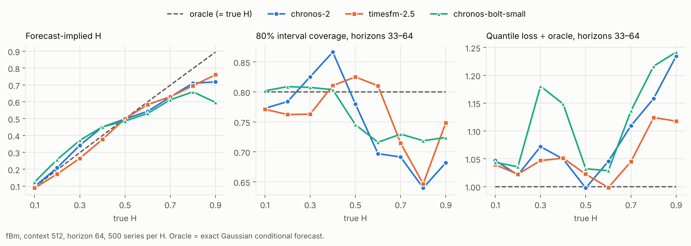

# Gate 1 pilot, stage A: foundation models on fractional Brownian motion

**Finding.** Chronos-2, TimesFM-2.5 and Chronos-Bolt (small) all shrink the Hurst exponent toward 1/2 in their forecast uncertainty. For persistent series (H ≥ 0.7) this leaves long-horizon intervals under-covering and the lower tail breached up to twice as often as nominal. Short-horizon calibration looks fine throughout, so standard short-horizon checks would not catch it.



## Setup

- **Data:** fBm at H = 0.1, 0.2, …, 0.9, with 500 series per H. Context is 512 steps and horizon 64. Each series gets a random scale (10^U(−1, 1)) and offset.
- **Models:**
  - `amazon/chronos-2`
  - `google/timesfm-2.5-200m-pytorch`, run with continuous quantile head and input normalisation
  - `amazon/chronos-bolt-small`
  - All are zero-shot, on CPU, with quantiles 0.1–0.9.
- **Oracle:** the exact Gaussian conditional law of the future given the 512 context points. It is optimal by construction. Its row in the tables is a sanity check: coverage came out 0.77–0.82 against 0.80, and its implied H matches the true H.
- **Forecast-implied H:** slope of log(80%-interval width) against log horizon. The oracle's prediction-error sd grows like k^H.
- **Context-estimated H:** `fsde.hurst_second_diff` on the context alone. Mean error at most 0.005 at every H.

Reproduce (about 10 min on 4 CPUs):

```bash
HF_HUB_DISABLE_XET=1 python pilot/gate1_fbm.py --n-series 500
python pilot/plot_gate1.py
```

## Results

Long-horizon numbers average horizons 33–64. The standard error of a coverage cell is about 0.014 (at most 0.019).

| H | Implied H: Chronos-2 / TimesFM-2.5 / Bolt | Long coverage (target 0.80) | Lower-tail exceedance (target 0.10) | Quantile loss ÷ oracle |
| --- | --- | --- | --- | --- |
| 0.3 | 0.34 / 0.27 / 0.37 | 0.83 / 0.76 / 0.81 | 0.09 / 0.11 / 0.12 | 1.07 / 1.05 / 1.18 |
| 0.5 | 0.50 / 0.50 / 0.49 | 0.78 / 0.82 / 0.75 | 0.13 / 0.10 / 0.17 | 1.00 / 1.02 / 1.03 |
| 0.7 | 0.63 / 0.63 / 0.61 | 0.69 / 0.71 / 0.73 | 0.18 / 0.16 / 0.18 | 1.11 / 1.05 / 1.14 |
| 0.8 | 0.71 / 0.70 / 0.66 | 0.64 / 0.65 / 0.72 | 0.19 / 0.19 / 0.17 | 1.16 / 1.12 / 1.22 |
| 0.9 | 0.72 / 0.76 / 0.60 | 0.68 / 0.75 / 0.72 | 0.18 / 0.13 / 0.14 | 1.24 / 1.12 / 1.24 |

Full tables are in `cells.csv` (per model and H), `curves.csv` (per horizon) and `series.csv` (per series).

**Gate 1 statistics**, across the 27 model × H cells (oracle excluded):

| Predictor | Outcome | Spearman ρ | p |
| --- | --- | --- | --- |
| Implied-H error (H_fc − true) | long-horizon coverage gap | 0.80 | 5 × 10⁻⁷ |
| Context Ĥ − implied H (**label-free**) | long-horizon coverage gap | −0.82 | 2 × 10⁻⁷ |
| \|Context Ĥ − implied H\| (label-free) | long-horizon quantile loss ÷ oracle | 0.80 | 5 × 10⁻⁷ |

Per series (4,500 per model), the label-free gap against long-horizon dispersion has ρ between 0.11 and 0.20, all with p < 10⁻¹². For the oracle it is −0.01 (p = 0.52), the negative control. A single series' realised errors are very noisy, so this is weak per series but systematic.

## What this does and does not show

- **Shown:** on fBm, models trained on real data do not track long memory beyond about H = 0.6. The error is invisible at short horizons and costs 10–25% in quantile loss at long horizons.
- **Overstated (see `../AUDIT_2026-11-11.md`):** the label-free gap's ρ = −0.82 is across cells, where the context Ĥ ≈ true H, so it mostly restates that coverage falls as H rises. Within a fixed H, its per-series correlation with long-horizon coverage averages only −0.17.
- **Not shown:** that this matters on real data. fBm with H = 0.9 is an extreme test, and the link between H error and long-horizon coverage is partly mechanical on fBm. Stage B (real series with long memory: realised volatility, hydrology, traffic) is the actual Gate 1 test.
- **Not separated:** how much of the miss comes from width scaling and how much from a misplaced median. For H > 1/2 the oracle mean extrapolates persistent trends. Chronos-Bolt at H = 0.8 has about the right width at k = 64 (×1.06) but still covers only 0.72, which suggests the median is also off.
- **One configuration:** context 512 and horizon 64 only, and the 80% interval only. TimesFM 3 was not tested: it is not on PyPI, and GitHub is not reachable from this environment.
